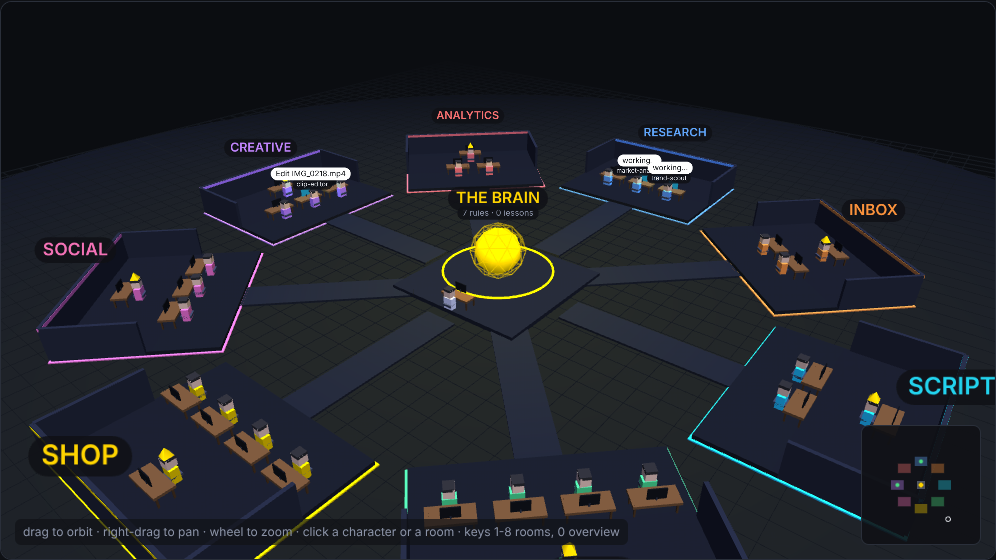

# Agents HQ

An AI office of 31 agents in 8 teams around one shared Brain, run by [Claude Code](https://claude.com/claude-code), with a 3D office you open in your browser to watch them work. You give the chief of staff a task in plain words; it routes the task to the right team, the team head plans, the workers run in parallel, the head reviews, and the result waits for your OK. Nothing is published, posted, sent or pushed without it.

Built from Bekhruz AI's "Build Your AI Team" videos: [I Built an AI Agent Team From Scratch](https://youtu.be/-14NKNpWr1M) (the creative team, the video tools, the permission rules; code from [bekhruztbx/ai-creative-team](https://github.com/bekhruztbx/ai-creative-team), MIT) and [I Built an AI Office With 31 Agents](https://youtu.be/t0hGE-aaAds) (the office: eight teams around the Brain, heads that plan and review, workers that do one job, and the 3D "Agents HQ" view).



## The office

| Team | Head (Opus) | Workers (Sonnet) |
|---|---|---|
| The Brain | the chief of staff (your Claude Code session) | the shared memory everyone reads |
| Research | research-director | market-analyst, competitor-analyst, trend-scout |
| Inbox | inbox-manager | customer-support, proposal-writer |
| Scripts | script-writer | hook-writer, seo-specialist |
| Dev | engineering-lead | frontend-dev, backend-dev, qa-tester, code-reviewer |
| Shop | shop-manager | copywriter, ads-specialist, finance-analyst, project-manager |
| Social | social-media-manager | community-manager, email-marketer, outreach-writer |
| Creative | creative-director | clip-editor, brand-checker, thumbnail-designer |
| Analytics | analytics-lead | data-analyst, strategist |

Every agent is one file in `.claude/agents/` with its job, its team, its tools and its steps. The full org chart is in `docs/office.md`. Six skills in `.claude/skills/` (reel, pixel, quill, radar, relay, pulse) hold the creative know-how and their scripts; the agents that need one preload it.

**The app** (`python hq/server.py`, opens http://localhost:7331):

| Screen | What you do there |
|---|---|
| **Office** | The 3D floor: the Brain in the middle, one room per team, one desk and character per agent, heads wear a hat. Screens light up and speech bubbles appear while an agent runs. "31 agents · N running" at the top. Drag to orbit, wheel to zoom, click a character for its card, click a room to fly to it, keys 1 to 8 jump to rooms, 0 is the overview, the minimap is bottom right |
| **Tasks** | The board (to do, doing, review, done) the chief of staff keeps, who is running now, and the live feed of agent starts and stops. Add a task and press Run |
| **Desk** | Clips waiting, work waiting for your OK, edited count, brand rules, and the lead's latest reply |
| **Inbox** | Drag raw clips, comment exports and analytics CSVs in |
| **Staff** | All 31 agents by team, with a light on whoever is working |
| **Work** | Finished edits with cover and video preview, notes and post copy. **Approve** moves a folder to `approved/` |
| **Brain** | Company, brand rules, lessons and ideas: what every agent reads. Teach a rule here |
| **Console** | Everything the lead does, as it happens |

The buttons at the bottom (Standup, Edit clips, What's next, Stats, Script…, Post copy…) and the message box talk to the chief of staff, which is Claude Code running headless in this folder with the repository's own permission rules. Each message continues the same conversation, so "OK" and "make it shorter" work.

**The office is live from the terminal too.** Hooks in `.claude/settings.json` append every agent start and stop to `hq/events.jsonl`; the office reads it. Run `claude` in this folder in one window, the app in another, give the chief of staff a task, and watch the characters work.

**It updates itself.** Every time you open the app it pulls the newest Agents HQ from GitHub before starting (set `HQ_NO_UPDATE=1` to skip that).

## The floor plan

```
Agents-HQ/
├── Open Agents HQ.command     double-click on a Mac to open the app (Windows: Open Agents HQ.bat)
├── CLAUDE.md                  the chief of staff's charter: teams, how work flows, the brain, the rules
├── docs/office.md             the org chart: every agent and its job
├── .claude/
│   ├── agents/                31 agents, one file each (team and role in the frontmatter)
│   ├── skills/                reel, pixel, quill, radar, relay, pulse (with their scripts)
│   ├── commands/              /brief /standup /research /campaign /edit-clips /script /whats-next /post-copy /stats /teach /tasks /hire
│   └── settings.json          what agents may do alone, what asks you, what is never allowed; the office hooks
├── .mcp.json                  the memory MCP server (the shared brain), started through hq/brain.js
├── brain/memory.jsonl         Company, Brand rules, Lessons, Ideas
├── hq/                        the app: server.py, app.html, office3d.js (+ vendor/three.min.js), login.html,
│                              tasks.js and tasks.json (the board), events.js and events.jsonl (the live feed), status.py
├── inbox/                     raw clips; inbox/radar/ comments; inbox/stats/ analytics CSVs; inbox/messages/ emails and DMs
├── work/<team>/<task>/        research, copy, plans, code notes: one folder per task
├── out/                       finished video work waiting for your OK
├── approved/                  what you approved in the app, ready for you to publish
├── done/                      raw clips whose edit is finished
├── setup.sh / setup.py        one-time setup (setup.py for Windows)
├── deploy/ and fly.toml       the hosted version (Docker, HTTPS, login)
└── LICENSE                    MIT
```

## Setup (once)

You need [Claude Code](https://claude.com/claude-code) (signed in), Node.js 18+, and for video editing also ffmpeg and Python 3.10+.

```bash
git clone https://github.com/johnooi5593-hue/Agents-HQ
cd Agents-HQ
bash setup.sh        # Windows: python setup.py
```

The first time you run `claude` in the folder, accept the trust dialog and allow the `memory` server. The app passes the allow list itself, so it works right away.

## Open the app

```bash
python3 hq/server.py      # Windows: python hq/server.py
```

Or double-click `Open Agents HQ.command` (Mac) or `Open Agents HQ.bat` (Windows). The browser opens http://localhost:7331. The app only listens on your own machine.

## Use it

| You type (or press) | What happens |
|---|---|
| `/brief write the listing for the new hoodie` | Routed to Shop: shop-manager plans, copywriter writes, brand-checker reviews |
| `/research AI video editing tools market` | market-analyst, competitor-analyst and trend-scout run in parallel; one brief with sources |
| `/campaign launch of the October drop` | Social and Shop heads plan; posts, replies, newsletter, outreach, ads, pricing and timeline run in parallel |
| `/edit-clips` | One clip-editor per clip in `inbox/`, in parallel, then brand-checker |
| `/script <topic>` · `/whats-next` · `/stats` · `/post-copy <clip>` | The Scripts head, the trend-scout, the data-analyst, the copywriter |
| `/standup` | Status of the folders, the board and the brain |
| `/tasks` · `/hire podcast-producer: turns long recordings into episode outlines` | The board · a new agent file and org-chart row |
| `/teach cover text is red, not yellow` | A rule saved to the brain that every agent follows from then on |

Or just talk. Tell it about your company once (*"We sell X to Y. Our voice is Z."*) and the chief of staff saves it to the brain.

Deliverables land in `work/<team>/<task>/` and `out/<clip>/`. Nothing is posted; you review and say OK.

## Host it, so your phone can reach it

The hosted version is the same app behind a login, in one Docker image. See `deploy/` and `fly.toml`. You need a server (Fly.io is the simplest), an Anthropic API key (a server can't use your Claude app login, so the office bills to the key; set a spend limit) and a password.

```bash
fly launch --no-deploy --copy-config --name my-agents-hq
fly volumes create hq_data --size 10
fly secrets set HQ_PASSWORD='a long password' ANTHROPIC_API_KEY='sk-ant-...' HQ_SECRET="$(openssl rand -hex 32)"
fly deploy
```

Or on any VPS with Docker: `cp deploy/.env.example deploy/.env`, fill it in, `docker compose -f deploy/docker-compose.yml up -d --build`. Caddy gets the HTTPS certificate by itself.

## Safety

- Agents may run the skill scripts and the board, write under `work/`, `out/`, `done/`, search the web, and read. Editing the charter, the agents, the skills, the brain file or the app asks you first (`.claude/settings.json`).
- `rm`, `curl`, `wget`, force pushes and reading `.env` are blocked. `git push` asks.
- Every deliverable is reviewed by a checker or a team head before you see it. Nothing is posted; you publish.
- Installing agents or skills from other people? Read them first, or ask the chief of staff to list every file, command and network call in one.

## Credits and license

MIT. The creative skills, their scripts and the team design come from Bekhruz AI's [ai-creative-team](https://github.com/bekhruztbx/ai-creative-team) (MIT); the office layout follows his 31-agent office video. Three.js (`hq/vendor/`) is MIT; the Geist font in the skill folders is under the SIL Open Font License.
