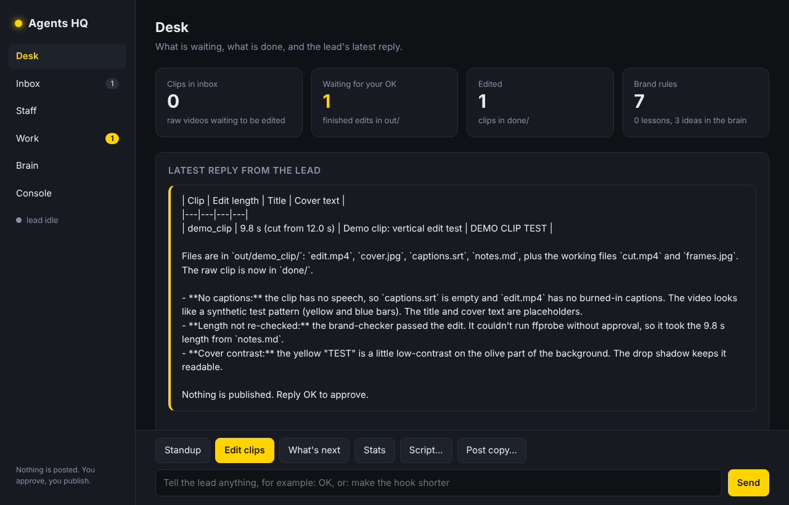

# Agents HQ

The headquarters of a small AI creative team that runs inside [Claude Code](https://claude.com/claude-code). Drop raw clips, comments and analytics into `inbox/`, and a lead agent puts the staff to work: clips get cut, captioned and covered in parallel, a checker reviews them against your brand rules, a scout turns comments into ideas, a scriptwriter writes in your voice, an analyst turns stats into lessons. A shared brain remembers your rules. Nothing is published without your OK.

It comes as an app you open in your browser (the desk, the inbox, the staff board, the work shelf, the brain and a live console) and as a plain [Claude Code](https://claude.com/claude-code) folder you can drive from the terminal. Both run the same team.



Built from Bekhruz AI's video [**I Built an AI Agent Team From Scratch (Claude Code)**](https://youtu.be/-14NKNpWr1M) and the [ai-creative-team](https://github.com/bekhruztbx/ai-creative-team) repo behind it. The video (episode 4 of the "Build Your AI Team" series) builds a lead plus parallel sub-agents with a shared memory brain. Episode 6 later turned every agent into a skill. Agents HQ keeps both ideas:

- **Skills hold the know-how.** Six playbooks in `.claude/skills/`, each with its own scripts.
- **Agents are the staff.** Six thin sub-agents in `.claude/agents/` that load a skill, work in their own context with only the tools they need, and run in parallel.
- **The desk is slash commands.** `/standup`, `/edit-clips`, `/script`, `/whats-next`, `/post-copy`, `/stats`, `/teach`.

## The floor plan

```
Agents-HQ/
├── Open Agents HQ.command     double-click on a Mac to open the app (Windows: Open Agents HQ.bat)
├── CLAUDE.md                  the HQ charter: staff, brain, folders, rules
├── .claude/
│   ├── agents/                the staff (sub-agents)
│   │   ├── clip-editor.md     one raw clip in, a captioned vertical edit + cover out
│   │   ├── brand-checker.md   reviews every edit against the brand rules (read-only)
│   │   ├── scriptwriter.md    scripts and hooks in your voice
│   │   ├── scout.md           comments in, a ranked shortlist of ideas out
│   │   ├── copywriter.md      titles, descriptions, captions, pinned comment
│   │   └── analyst.md         analytics CSVs in, lessons for the team out
│   ├── skills/                the playbooks (reel, pixel, quill, radar, relay, pulse)
│   │   ├── reel/scripts/      cut.py, captions.py, frames.py (+ media.py helpers)
│   │   └── pixel/scripts/     thumbnail.py
│   ├── commands/              the desk (/standup, /edit-clips, /script, /whats-next, /post-copy, /stats, /teach)
│   └── settings.json          what the team may do alone, what it must ask, what it may never do
├── .mcp.json                  the memory MCP server (the shared brain)
├── brain/memory.jsonl         brand rules, lessons, ideas
├── hq/server.py               the Agents HQ app: a local web server over the team (no dependencies)
├── hq/app.html                the app's screen
├── hq/status.py               one JSON line with the state of inbox, out, done and the brain
├── inbox/                     raw clips; inbox/radar/ comments and notes; inbox/stats/ analytics CSVs
├── out/                       finished work waiting for your OK
├── approved/                  what you approved in the app, ready for you to publish
├── done/                      raw clips whose edit is finished
└── setup.sh                   one-time setup
```

## Who does what

| Staff | Skill | In | Out |
|---|---|---|---|
| clip-editor | reel + pixel | `inbox/<clip>.mp4` | `out/<clip>/edit.mp4`, `cover.jpg`, `captions.srt`, `notes.md` |
| brand-checker | (the brand rules) | `out/<clip>/` | `PASS` or `FIX: what, which file, which option` |
| scriptwriter | quill | a topic | `out/scripts/<slug>.md` |
| scout | radar | `inbox/radar/*` | `out/radar/shortlist.md` + "Ideas" in the brain |
| copywriter | relay | `out/<clip>/notes.md` | `out/<clip>/post.md` |
| analyst | pulse | `inbox/stats/*.csv` | `out/pulse/report.md` + "Lessons" in the brain |

The lead (your Claude Code session) reads `CLAUDE.md`, delegates, runs the clip-editors in parallel, sends everything through the brand-checker, and reports. For a small single task it can use a skill directly instead of delegating.

## Setup (once)

You need [Claude Code](https://claude.com/claude-code), ffmpeg, Python 3.10+ and Node.js 18+.

```bash
git clone https://github.com/johnooi5593-hue/Agents-HQ
cd Agents-HQ
bash setup.sh
```

`setup.sh` installs numpy, pillow and a local speech-to-text engine (faster-whisper, or sherpa-onnx Whisper as a fallback), creates the folders and prints the HQ status. Speech-to-text runs on your machine; nothing is uploaded.

The first time you run `claude` in the folder, accept the trust dialog and approve the `memory` MCP server. Until a folder is trusted, Claude Code ignores the allow list in `.claude/settings.json` and asks before every step. Headless runs (`claude -p`) show no dialog, so trust the folder interactively once first.

## Open the app

```bash
python3 hq/server.py
```

Or double-click `Open Agents HQ.command` (Mac) or `Open Agents HQ.bat` (Windows). Your browser opens http://localhost:7331.

| Screen | What you do there |
|---|---|
| **Desk** | The numbers (clips waiting, work waiting for your OK, edited, brand rules) and the lead's latest reply |
| **Inbox** | Drag raw clips, comment exports and analytics CSVs in |
| **Staff** | The six agents; a green light means that agent is working right now |
| **Work** | Finished edits with cover and video preview, notes and post copy. **Approve** moves a folder to `approved/` |
| **Brain** | The brand rules, lessons and ideas every agent reads. Teach a new rule here |
| **Console** | Everything the lead and the staff do, as it happens |

The buttons at the bottom (Standup, Edit clips, What's next, Stats, Script…, Post copy…) and the message box all talk to the lead. The lead is Claude Code running headless in this folder (`claude -p`) with the project's permission rules, so the app can do exactly what the terminal can, and nothing more. Each message continues the same conversation, so "OK" or "make the hook shorter" works. The app only listens on your own machine (127.0.0.1).

## Use it from the terminal

Start Claude Code in this folder (`claude`) and use the desk:

| Command | What happens |
|---|---|
| `/standup` | Inbox, work waiting for approval, what the brain knows, suggested next move |
| `/edit-clips` | One clip-editor per clip in `inbox/`, in parallel, then the brand-checker, then a table for your OK |
| `/script <topic>` | The scriptwriter writes a reel script (or a YouTube script if you give a length) |
| `/whats-next` | The scout reads `inbox/radar/` and shortlists 3 ideas |
| `/post-copy <clip>` | The copywriter writes title, description, captions and a pinned comment for `out/<clip>/` |
| `/stats` | The analyst reads `inbox/stats/` and saves 3 lessons every script follows from then on |
| `/teach <rule>` | Saves a brand rule to the brain (`/teach` alone lists the current rules) |

Or just talk: *"There's a new clip in inbox, make it a reel."*, *"What should I make next?"*, *"Here are this month's stats, what worked?"*

Finished work lands in `out/`. Raw clips move to `done/` after their edit passed the check. Tip: make `inbox/` a cloud-synced folder and clips you drop on your phone land at HQ.

## Teach it your style

Tell the lead a preference (*"From now on, cover text is red, not yellow."*) or use `/teach`. The rule goes into the shared brain (`brain/memory.jsonl`), and every agent and skill follows it from the next run on. The starting rules are in that file; edit them to match your channel.

Skills improve too. When a step keeps going wrong, the lead proposes a change to that skill's `SKILL.md`, shows the diff, and saves it only after you say OK (`.claude/settings.json` asks before any edit under `.claude/`).

## Safety

- The team may only run the skill scripts and `hq/status.py`, move clips from `inbox/` to `done/`, and write into `out/` (`.claude/settings.json`).
- The app runs the lead with those same rules. It never adds permissions; it only sends messages, saves your uploads into `inbox/` and moves approved work to `approved/`.
- Deleting files and network tools like `curl` and `wget` are blocked. Pushing to git and editing the charter, the agents, the skills or the brain file asks you first.
- Nothing is uploaded or posted. You review `out/` and publish yourself.
- Installing skills or agents from other people? Read them first, or ask the lead to list every file, command and network call in one before you use it.

## Credits and license

MIT. The playbooks, scripts and team design come from Bekhruz AI's [ai-creative-team](https://github.com/bekhruztbx/ai-creative-team) (MIT), rearranged into an HQ with staff agents, a desk of commands and a status script. The Geist font in the skill folders is under the SIL Open Font License.
